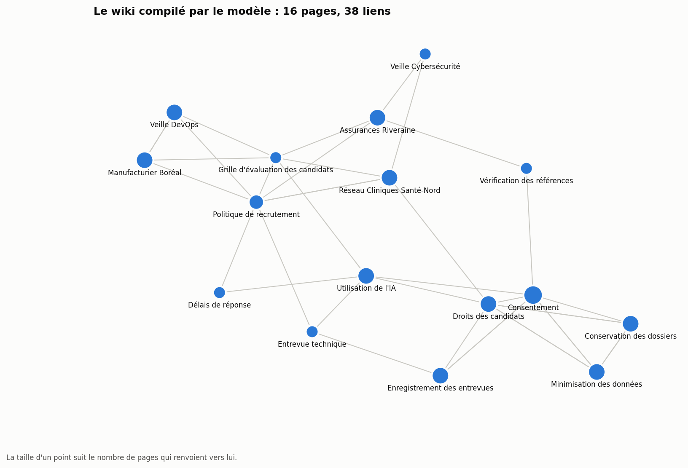
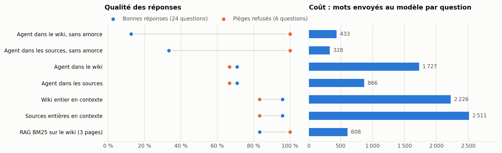

# llm-wiki-recrutement

[](https://github.com/frejoyal/llm-wiki-recrutement/actions/workflows/verification.yml)

> **Entreprise, clients et documents fictifs.** Recrutement Élite inc., ses employés, ses trois clients et ses 14 documents sont inventés ; seules les villes sont réelles.
>
> **Fictional company, clients and documents.** See the [English section](#english).

Le pattern « LLM Wiki », appliqué avec un modèle local et mesuré. Au lieu de chercher dans les documents bruts à chaque question, un modèle de langage compile les documents en un wiki Markdown qu'il tient à jour : des pages par sujet, reliées par des liens, qu'on peut ouvrir dans Obsidian. Andrej Karpathy a décrit ce pattern en avril 2026 dans son [gist « llm-wiki »](https://gist.github.com/karpathy/442a6bf555914893e9891c11519de94f), autour de trois opérations : ingérer, interroger et vérifier.

Ce dépôt applique les trois opérations avec `gemma4:e4b`, qui tourne sur le poste. Il compare ensuite le wiki à des approches plus simples, sur 30 questions. Chaque résultat publié se reconstruit à l'identique à chaque modification du dépôt.



## Le mandat

Recrutement Élite inc., un cabinet de recrutement en TI, veut un assistant qui répond aux questions de ses recruteurs sur ses règles internes et ses clients : le seuil de la grille d'évaluation, la garantie d'un client, ce qu'on peut faire avec un outil d'IA. Les réponses sont dispersées dans 14 documents écrits de janvier à mai 2026 : politique, grille, guide sur la Loi 25, procédures, notes de veille, fiches clients, compte rendu de réunion, note de la direction, courriel d'un client. Certains documents en contredisent de plus anciens. Les renseignements des candidats étant protégés par la Loi 25, le cabinet veut un modèle qui tourne sur ses propres postes.

## Le pattern, en trois opérations

```text
sources/      les 14 documents bruts, jamais modifiés
AGENTS.md     les règles du wiki : une page par sujet, des faits, des liens, la source la plus récente l'emporte
wiki/         les pages écrites par le modèle, avec index.md et journal.md ; s'ouvre comme un coffre Obsidian
```

1. **Ingérer** ([wiki_llm/ingerer.py](wiki_llm/ingerer.py)). Les sources passent une à une, dans l'ordre des dates. Pour chacune, le modèle lit l'index et choisit de 1 à 4 pages à créer ou à modifier. Il réécrit ensuite chaque page au complet, en gardant ce qui reste vrai. Le code tient l'en-tête de chaque page (sources, date de mise à jour), l'index et le journal : le modèle n'écrit que le contenu. Ce flux guidé convient mieux à un petit modèle qu'un agent libre.
2. **Vérifier** ([wiki_llm/verifier.py](wiki_llm/verifier.py)). Des contrôles faits par le code : liens brisés, pages orphelines, pages sans source, sources jamais citées, pages absentes de l'index, doublons probables. Après la vérification vient l'entretien : chaque page orpheline reçoit des liens entrants, choisis par le modèle.
3. **Interroger** ([wiki_llm/repondre.py](wiki_llm/repondre.py)). Un agent part de l'index, lit des pages et suit des liens avec deux outils, `lire_page` et `chercher`. Il cite chaque page utilisée et répond `INCONNU` quand le wiki ne contient pas la réponse.

```bash
python -m wiki_llm.repondre "Quelle est la garantie de remplacement d'Assurances Riveraine ?"
```

## Ce que le modèle a produit

Le modèle a compilé 14 documents (2 400 mots) en 16 pages, avec 46 appels. Le [journal](wiki/journal.md) donne le détail de chaque ingestion.

| Vérification | Avant l'entretien | Après l'entretien |
|---|--:|--:|
| Liens entre les pages | 17 | 41 |
| Liens brisés | 0 | 0 |
| Pages orphelines | 8 | 0 |
| Pages sans source, sources jamais citées, doublons | 0 | 0 |

**Ce qui a marché.** Les mises à jour sont appliquées : la conservation des dossiers passe de 6 à 12 mois avec l'historique, la garantie de 120 jours d'Assurances Riveraine est dans sa page client, et les nouvelles exigences de Santé-Nord sont intégrées.

**Ce que le modèle a raté**, et que la vérification par le code ne voit pas :

- la veille sur l'ingénierie des données a été rangée dans la page « Veille DevOps » au lieu d'avoir sa page ;
- le rôle de Marc-André Pelletier, responsable de la protection des renseignements personnels, n'apparaît plus : il était dans la signature du guide, pas dans son texte ;
- la page de la politique ne mentionne pas la garantie de 120 jours d'Assurances Riveraine, contrairement à la règle d'AGENTS.md sur les exceptions ;
- l'entretien a relié toutes les pages orphelines, mais certains liens sont peu pertinents (la grille d'évaluation renvoie vers un client).

## Les questions

30 questions, écrites et figées avant les mesures, dans [evaluation/questions.json](evaluation/questions.json) :

| Type | Nombre | Exemple |
|---|--:|---|
| Fait | 13 | « Quel est le seuil de points pour présenter un candidat à un client ? » |
| Mise à jour | 5 | « Combien de temps conserve-t-on le dossier d'un candidat non retenu ? » (la règle a changé en mai) |
| Synthèse | 6 | « Quels clients exigent une vérification des antécédents judiciaires ? » (deux documents) |
| Piège | 6 | « Quel salaire est offert pour le poste DevOps chez Manufacturier Boréal ? » (aucun document ne le dit) |

La correction est automatique. Une réponse est bonne si elle contient la valeur attendue, et un piège est réussi si la réponse dit que l'information manque.

## Résultats

Le même modèle répond de sept façons :

| Méthode | Bonnes réponses | Faits | Mises à jour | Synthèses | Pièges refusés | Refus à tort | Appels LLM | Mots envoyés |
|---|--:|--:|--:|--:|--:|--:|--:|--:|
| Agent dans le wiki, sans amorce | 12 % | 15 % | 0 % | 17 % | 100 % | 83 % | 1,6 | 433 |
| Agent dans les sources, sans amorce | 33 % | 54 % | 0 % | 17 % | 100 % | 58 % | 2,0 | 328 |
| Agent dans le wiki | 71 % | 85 % | 60 % | 50 % | 67 % | 8 % | 2,4 | 1 727 |
| Agent dans les sources | 71 % | 100 % | 40 % | 33 % | 67 % | 21 % | 2,8 | 866 |
| Wiki entier en contexte | **96 %** | 92 % | 100 % | 100 % | 83 % | 4 % | 1 | 2 226 |
| Sources entières en contexte | **96 %** | 100 % | 100 % | 83 % | 83 % | 0 % | 1 | 2 511 |
| RAG BM25 sur le wiki (3 pages) | 83 % | 92 % | 80 % | 67 % | **100 %** | 8 % | 1 | 608 |

Les coûts sont des moyennes par question. Les réponses complètes et les pages lues pour chaque question sont dans [resultats/resultats.json](resultats/resultats.json).



### Ce qu'on en retient

1. **À cette taille, tout donner au modèle reste le plus simple et le plus juste.** 14 documents tiennent dans le contexte : avec le wiki entier ou les sources entières, le modèle répond juste à 96 % des questions, en un seul appel. Compiler un wiki n'améliore pas ce score.
2. **Le wiki rend une recherche ciblée efficace.** Trois pages du wiki trouvées par BM25 suffisent pour 83 % de bonnes réponses, avec quatre fois moins de texte envoyé. C'est aussi la seule méthode qui refuse les six pièges tout en répondant à presque toutes les vraies questions (8 % de refus à tort). Une page par sujet, à jour, se prête mieux à la recherche qu'un document qui mêle plusieurs sujets.
3. **Le wiki aide surtout quand les règles changent.** L'agent qui lit les sources tombe sur la fiche de Santé-Nord de mars et répond « 3 jours de télétravail », alors qu'un courriel de mai a changé la règle. Dans le wiki, la page est déjà à jour. Pour les mises à jour, l'agent passe de 40 % à 60 %.
4. **Un petit modèle a besoin d'un harnais.** Sans amorce, l'agent répond presque toujours « je ne trouve aucune information » sans rien lire (12 % de bonnes réponses). Ses 100 % de pièges refusés ne valent donc rien, puisqu'il refuse aussi 83 % des vraies questions. Avec l'index déjà ouvert au départ et une relance quand il n'a rien lu, il atteint 71 %. Il reste moins bon que la lecture du wiki entier : il s'arrête parfois après une seule page, ou renvoie une réponse vide.
5. **Compiler, c'est aussi perdre.** Le rôle du responsable de la protection des renseignements personnels a disparu à la compilation, et toutes les méthodes qui lisent seulement le wiki échouent à cette question, alors que celles qui lisent les sources la réussissent. Les sources restent donc dans le dépôt, et chaque page dit de quels documents elle vient.
6. **Une confusion résiste :** à la question sur la commission des recruteurs, quatre des sept méthodes répondent avec les honoraires facturés au client (20 %), qui sont autre chose.

### Quand choisir quoi

- **Une petite base stable**, qui tient dans le contexte du modèle : tout donner au modèle.
- **Une base qui grandit et qui change**, dont les documents se contredisent avec le temps : un wiki compilé et vérifié, interrogé par une recherche ciblée. Le wiki porte les mises à jour, la recherche garde le coût bas.
- **Un grand nombre de documents semblables**, comme des CV : un RAG avec recherche hybride et reclassement. Ce cas est mesuré dans [rag-recrutement-bench](https://github.com/frejoyal/rag-recrutement-bench).

### Limites

- L'échantillon est petit : 30 questions, une seule exécution, un seul modèle. Une question vaut 4 points sur les bonnes réponses, et un piège en vaut 17.
- Les documents et les questions ont été écrits par la même personne, avant les mesures.
- Les mesures ont révélé deux défauts du protocole, corrigés ensuite et publiés tels quels :
  - **L'agent sans amorce ne lisait presque rien.** L'amorce a été ajoutée, et la version sans amorce reste dans les résultats.
  - **La correction automatique était trop littérale.** Elle ne reconnaissait pas un refus formulé en phrase (« je ne trouve aucune information »), ni « anglais » dans « français-anglais », ni « une troisième référence » comme réponse à « combien de références ». Les questions n'ont pas changé ; seule la forme « troisième » a été ajoutée aux réponses acceptées pour la question sur les postes de gestion.

## Utiliser le wiki

- **Obsidian :** ouvrez le dossier `wiki/` comme coffre. La vue graphique montre les liens entre les pages.
- **Claude Desktop :** le serveur MCP de fichiers donne au modèle l'accès au wiki ; un exemple de configuration est dans [mcp/claude_desktop_config.exemple.json](mcp/claude_desktop_config.exemple.json). Remplacez le chemin par celui du dossier `wiki/`.
- **Claude Code ou un autre agent :** ouvrez le dépôt. [AGENTS.md](AGENTS.md) donne les règles du wiki.

## Reproduire

Le dépôt contient un cache de toutes les réponses du modèle ([resultats/cache-modele.json](resultats/cache-modele.json)). Le wiki et les résultats se reconstruisent donc sans modèle ni réseau :

```bash
pip install -r requirements.txt
python -m wiki_llm.ingerer --verifier    # recompile le wiki à partir des sources et le compare au wiki publié
python -m wiki_llm.verifier --verifier   # refait la vérification et la compare au rapport publié
python -m wiki_llm.evaluer --verifier    # répond aux 30 questions de sept façons et compare aux résultats publiés
```

La CI fait la même chose à chaque modification du dépôt. Pour tout recalculer avec le modèle, il faut [Ollama](https://ollama.com) avec `gemma4:e4b`, puis :

```bash
pip install -r requirements-modeles.txt
python -m wiki_llm.ingerer --mode direct
python -m wiki_llm.verifier
python -m wiki_llm.evaluer --mode direct
python resultats/graphiques.py
```

Le modèle répond avec une température de 0 et un germe fixe.

## Structure

```text
sources/       les 14 documents fictifs du cabinet
AGENTS.md      les règles du wiki
wiki/          le wiki compilé par le modèle (coffre Obsidian), avec index.md et journal.md
wiki_llm/      l'ingestion, la vérification, les sept façons de répondre et l'évaluation
evaluation/    les 30 questions et leurs réponses attendues
resultats/     les résultats, les rapports de vérification, les images et le cache du modèle
mcp/           un exemple de configuration MCP pour Claude Desktop
```

Le code a été écrit avec l'aide de Claude. Le wiki est écrit par `gemma4:e4b`, en local.

## English

**Fictional company, clients and documents.** Recrutement Élite inc., its staff, its three clients and its 14 documents are made up; only the cities are real.

The "LLM Wiki" pattern, run with a local model and measured. Instead of searching raw documents at every question, a language model compiles them into a Markdown wiki it keeps up to date: one page per topic, linked, viewable in Obsidian. Andrej Karpathy described the pattern in April 2026 in his [llm-wiki gist](https://gist.github.com/karpathy/442a6bf555914893e9891c11519de94f), around three operations: ingest, query and lint.

- **Ingest:** 14 fictional internal documents of a Québec IT recruitment firm (policies, procedures, client sheets, meeting notes, a memo and an email, some contradicting older ones) are compiled by `gemma4:e4b` into 16 wiki pages. Each source is processed in date order: the model picks the pages to create or update, then rewrites each page. Code keeps provenance, the index and the log.
- **Lint:** code checks broken links, orphan pages, provenance and likely duplicates. A maintenance pass then has the model link the 8 orphan pages (17 links before, 41 after). Mistakes code cannot see are reported: misfiled content, a lost fact, a few irrelevant links.
- **Query:** a tool-using agent reads the index, opens pages and cites them, or answers `INCONNU`.
- **Evaluation:** 30 French questions (facts, updated rules, multi-document synthesis, traps), seven answering methods with the same model. With everything in context (wiki or raw sources), 96% correct. BM25 over three wiki pages gets 83% with four times fewer words sent, and rejects all six traps. The wiki helps most with changing rules: the raw-source agent reads an outdated client sheet, while the wiki page is already updated. A small model needs a harness: without the index pre-loaded, the agent answers "no information" without reading (12%).
- **Reproducibility:** every model response is cached in the repo; CI recompiles the wiki, re-runs the lint and the 30 questions without a model, and fails on any difference.

The code was written with help from Claude. The wiki is written by `gemma4:e4b`, locally.

## Licence

[MIT](LICENSE). License: [MIT](LICENSE).
